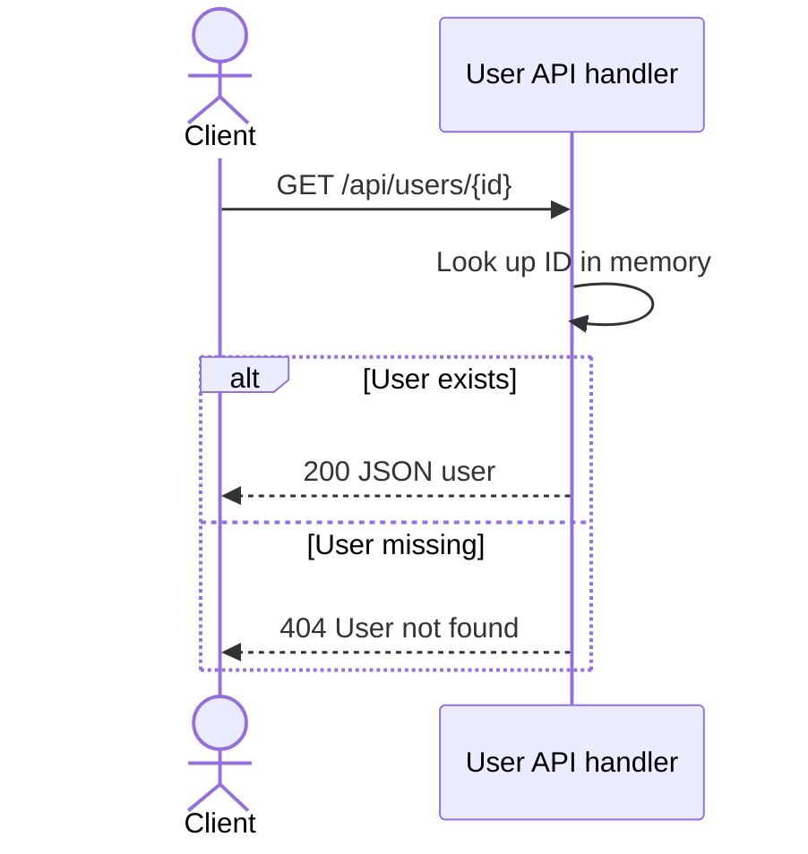

# Sequence diagrams for API specs

Add a `## Request flow` section with a fenced `mermaid` `sequenceDiagram` to each
created or substantially updated endpoint spec when source supports the flow.
If ordering or participants cannot be established, record that gap rather than
drawing an invented sequence. Preserve and reconcile existing handwritten diagrams.

Use the relationship map for participant identity and actual handler call sites
for temporal order. A dependency graph alone does not establish sequence.

- Start with the caller and endpoint handler. Add downstream services, storage,
  or event infrastructure only when source evidence shows their participation.
- Use short diagram-safe IDs and descriptive labels. Distinguish internal modules
  from deployed services, matching `.speckub/relations.md`.
- Show the main request and response with relevant methods and status codes.
- Use `alt`/`else` for significant observed success/error branches, `opt` for
  conditional work, `loop` for real repetition/retries, and `par` only for proven
  concurrency. Do not invent retry policies or depict sequential work as parallel.
- Distinguish synchronous calls, asynchronous messages, and responses with an
  explained arrow convention. Do not imply an async task completes before the
  response unless the implementation waits for it.
- Keep one readable main diagram; split complex scenarios into named diagrams.
  Do not mirror every function call or include credentials/personal data.

For example, an endpoint that reads an in-memory user collection can use:

Adapt this example to actual evidence; do not copy its behavior into unrelated
endpoints. After the diagram, cite repository-relative files/symbols and describe
unresolved order or branch details. Keep the diagram consistent with response
tables, business rules, and relationship descriptions.

Render/check Mermaid syntax with an existing renderer when available. If no
renderer is available, report the diagram as source-reviewed but not render-tested.
The deterministic SpecKub CLI checks frontmatter and source references; it does
not parse Mermaid or prove the diagram's runtime behavior.
