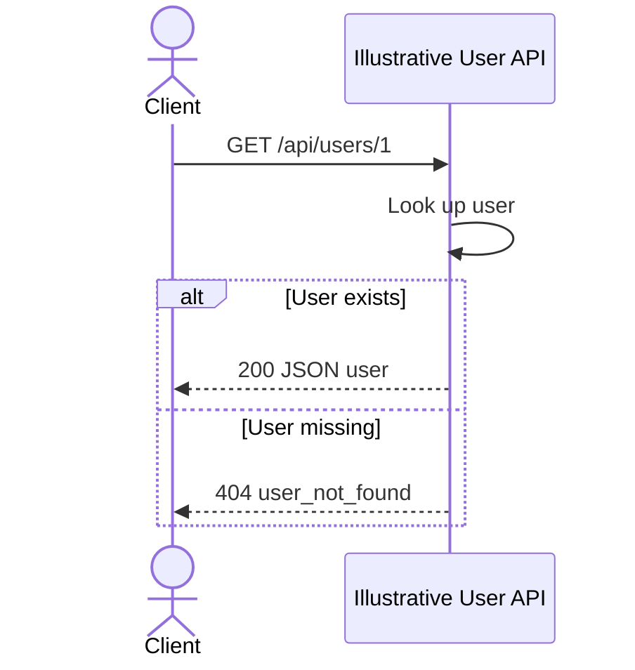

# Get a user — illustrative example

## Overview

This fictional API demonstrates the document layout. It is not a discovered
endpoint, source-backed specification, or tested implementation in your project.

## Contract

| Property            | Value                                       |
| ------------------- | ------------------------------------------- |
| Method and route    | `GET /api/users/{id}`                       |
| Request media type  | No body                                     |
| Response media type | `application/json`                          |
| Version             | Not specified in this illustrative contract |

## Authentication and authorization

This illustrative contract requires no credentials. That is an example design
choice, not a claim about your application's authentication or gateway.

## Request

| Field | Location | Type   | Required / nullable | Constraints / default        | Meaning |
| ----- | -------- | ------ | ------------------- | ---------------------------- | ------- |
| id    | Path     | string | Required, non-null  | Nonempty segment; no default | User ID |

No query parameters or request body are defined in this example.

## Responses

| Status | Condition           | Body         |
| ------ | ------------------- | ------------ |
| 200    | User exists         | User object  |
| 404    | User does not exist | Error object |

| Field | Type   | Required / nullable | Meaning      |
| ----- | ------ | ------------------- | ------------ |
| id    | string | Present, non-null   | User ID      |
| name  | string | Present, non-null   | Display name |

## Errors

| Status | Code / message   | Trigger    | Caller action |
| ------ | ---------------- | ---------- | ------------- |
| 404    | `user_not_found` | Unknown ID | Check the ID  |

The illustrative error body is `{ "error": "user_not_found" }`.

## Behavior

Look up a user without modifying state. No retry policy is defined. A real spec
must replace these fictional rules with evidence from the selected implementation.

## Relationships

No downstream service is included in this simplified example. Do not infer that
your application's user lookup has no database or service dependencies.

## Request flow



## Examples

Illustrative request only; `api.example.invalid` is not a live test endpoint:

```sh
curl https://api.example.invalid/api/users/1
```

Illustrative 200 response:

```json
{ "id": "1", "name": "Ada" }
```

Illustrative request for a missing user:

```sh
curl https://api.example.invalid/api/users/missing
```

Illustrative 404 response:

```json
{ "error": "user_not_found" }
```

## Limits and operations

Rate limits, timeouts, deployment settings, and performance guarantees are not
defined by this example. A real document must record evidence or explicit gaps.

## Evidence and verification

No source evidence is claimed. These examples have not been sent to a server.
The diagram is illustrative and not render-tested. Frontmatter can be checked
independently; it does not establish that the fictional endpoint exists.
