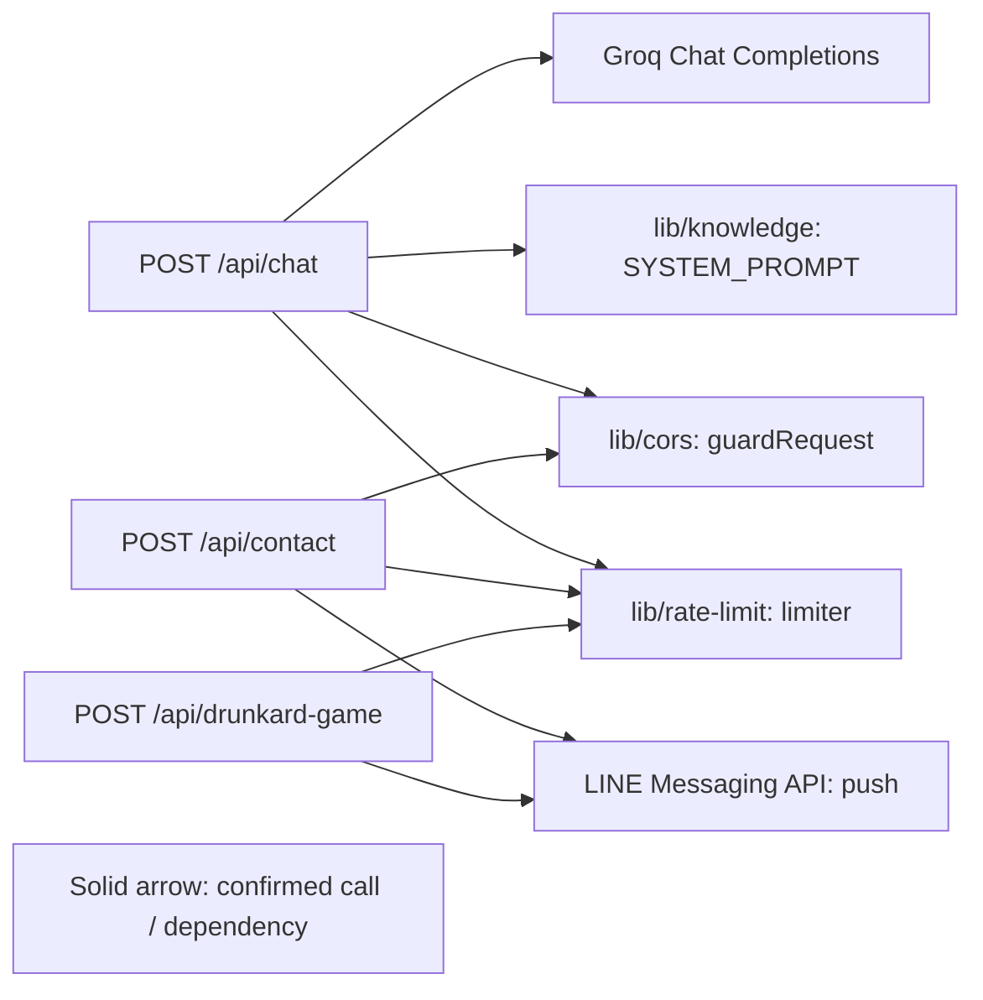

# API and service relationships

## Scope and coverage

- Root: `.`
- Scope: `portfolio-api` service and the three confirmed API identities in `.speckub/scan.md`
- Inventory used: `.speckub/scan.md`; revision was not available in the scan
- Services inspected: `portfolio-api`
- Coverage: handler calls, local helper usage, outbound HTTP targets, route registration, and `vercel.json`
- Gaps: The separate portfolio frontend repository is not part of this scope, so caller-side integrations were not traced. Vercel's production file-based routing is documented by configuration and mirrored in `dev-server.ts`; deployed runtime routing was not executed or independently inspected. No dynamic route registration or event/topic consumers were found in the inspected source.

## Nodes

| Stable node ID | Type | Owning service | Method / path | Source evidence |
| -------------- | ---- | -------------- | ------------- | --------------- |
| `portfolio-api.chat.post` | API | `portfolio-api` | `POST /api/chat` | `dev-server.ts` `ROUTES`; `api/chat.ts` `handler` |
| `portfolio-api.contact.post` | API | `portfolio-api` | `POST /api/contact` | `dev-server.ts` `ROUTES`; `api/contact.ts` `handler` |
| `portfolio-api.drunkard-game.post` | API | `portfolio-api` | `POST /api/drunkard-game` | `dev-server.ts` `ROUTES`; `api/drunkard-game.ts` `handler` |
| `portfolio-api.lib.cors` | Internal module | `portfolio-api` | N/A | `lib/cors.ts`: `guardRequest`, `clientKey` |
| `portfolio-api.lib.knowledge` | Internal module | `portfolio-api` | N/A | `lib/knowledge.ts`: `SYSTEM_PROMPT` |
| `portfolio-api.lib.rate-limit` | Internal module | `portfolio-api` | N/A | `lib/rate-limit.ts`: `createRateLimiter` |
| `external.groq.chat-completions` | External service | External; reached by `portfolio-api` | `POST https://api.groq.com/openai/v1/chat/completions` | `api/chat.ts`: `GROQ_ENDPOINT`, `handler` |
| `external.line.push` | External service | External; reached by `portfolio-api` | `POST https://api.line.me/v2/bot/message/push` | `api/contact.ts` and `api/drunkard-game.ts`: `LINE_PUSH_ENDPOINT`, `handler` |

## Directed edges

| Source ID | Target ID | Interaction type / protocol | Condition / trigger | Evidence | Confidence | Explanation |
| --------- | --------- | --------------------------- | ------------------- | -------- | ---------- | ----------- |
| `portfolio-api.chat.post` | `portfolio-api.lib.cors` | In-process function calls | Every request; `guardRequest` can terminate on preflight, method, or origin checks | `api/chat.ts` `handler`; `lib/cors.ts` `guardRequest` | confirmed | The handler calls `guardRequest` before API-key lookup and request processing. |
| `portfolio-api.chat.post` | `portfolio-api.lib.knowledge` | In-process module data use | Valid chat request reaches the Groq request construction | `api/chat.ts` `handler`; `lib/knowledge.ts` `SYSTEM_PROMPT` | confirmed | The system prompt is included in the messages sent upstream. |
| `portfolio-api.chat.post` | `portfolio-api.lib.rate-limit` | In-process function calls | After origin/method guard and API-key check; rate limit is checked before body validation | `api/chat.ts` `checkRateLimit`; `lib/rate-limit.ts` `createRateLimiter` | confirmed | Chat constructs a limiter and invokes it using `clientKey`. |
| `portfolio-api.chat.post` | `external.groq.chat-completions` | Outbound HTTPS JSON request | Valid request, configured `GROQ_API_KEY`, and allowed rate limit | `api/chat.ts` `GROQ_ENDPOINT`, `handler` | confirmed | The handler sends a POST using the configured key; provider failures become upstream errors. |
| `portfolio-api.contact.post` | `portfolio-api.lib.cors` | In-process function calls | Every request; `guardRequest` handles preflight, method, and origin checks | `api/contact.ts` `handler`; `lib/cors.ts` `guardRequest` | confirmed | Contact uses the shared request guard before its remaining processing. |
| `portfolio-api.contact.post` | `portfolio-api.lib.rate-limit` | In-process function calls | Valid non-honeypot submission, after payload validation | `api/contact.ts` `checkRateLimit`; `lib/rate-limit.ts` `createRateLimiter` | confirmed | Contact constructs a limiter and invokes it using `clientKey`. |
| `portfolio-api.contact.post` | `external.line.push` | Outbound HTTPS JSON request | Valid submission, required LINE configuration, and allowed rate limit | `api/contact.ts` `LINE_PUSH_ENDPOINT`, `handler` | confirmed | The handler sends a LINE push request using `LINE_CHANNEL_ACCESS_TOKEN` and `LINE_USER_ID`. |
| `portfolio-api.drunkard-game.post` | `portfolio-api.lib.rate-limit` | In-process function calls | After OPTIONS/method checks, secret-header verification, and payload validation | `api/drunkard-game.ts` `checkRateLimit`; `lib/rate-limit.ts` `createRateLimiter` | confirmed | This handler constructs and calls the shared limiter; it does not use `guardRequest`. |
| `portfolio-api.drunkard-game.post` | `external.line.push` | Outbound HTTPS JSON request | Valid payload, matching `x-secret-key` against `DRUNKARD_GAME_SECRET_KEY`, and allowed rate limit | `api/drunkard-game.ts` `verifySecretHeader`, `LINE_PUSH_ENDPOINT`, `handler` | confirmed | The handler sends a LINE push request using `LINE_CHANNEL_ACCESS_TOKEN` and `LINE_USER_ID`. |

No API-to-API, event, or callback edges were discovered. Shared rate limiting code means shared implementation, not shared counters: each endpoint creates its own limiter instance. The external LINE node represents the same provider endpoint called by two distinct APIs.

## Flowchart

All drawn edges are confirmed. No inferred edges are drawn; there are no dashed relationships.

## Questions and disputed mappings

- Caller-side integrations from the portfolio frontend were not inspected because that repository is outside this workspace scope.
- `dev-server.ts` explicitly maps each local route, while `vercel.json` configures `api/*.ts` functions; no production deployment was contacted to verify deployed routing.
- No potentially stale relationships were found in a prior relationship artifact; this file was newly created.
