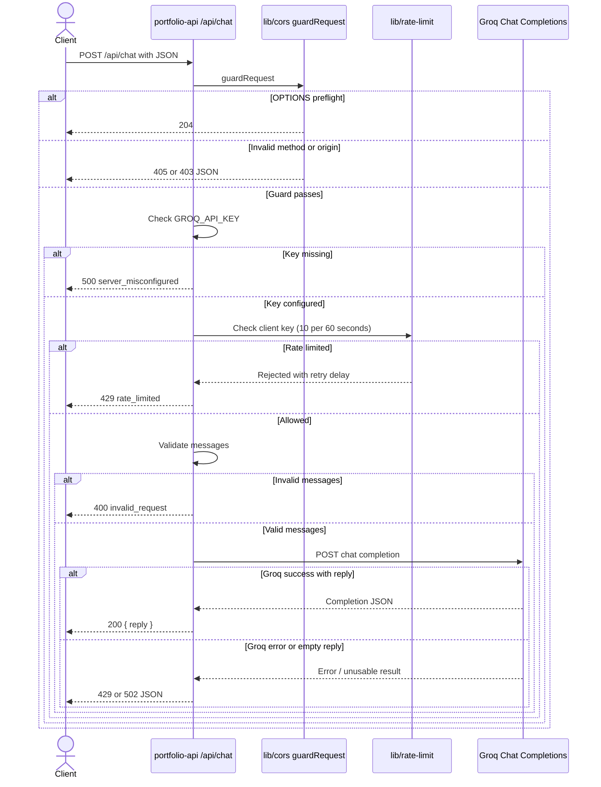

# Portfolio chat completion

## Overview

Accepts a visitor conversation, applies request and rate checks, sends it to Groq's chat-completions API, and returns the generated reply. The handler builds the model prompt from the local `SYSTEM_PROMPT` and an additional language directive based on the latest visitor message.

## Contract

| Property | Value |
| --- | --- |
| Method and route | `POST /api/chat` |
| Request media type | `application/json` |
| Response media type | `application/json` |
| Version | Not specified in source |

## Authentication and authorization

There is no visitor account authentication. `guardRequest` requires a present `Origin` matching the allowlist in `lib/cors.ts`; allowed origins are `https://kittipat.dev`, `https://www.kittipat.dev`, and `https://ipondnakab.github.io`. The handler requires server-side `GROQ_API_KEY`; its value is not included here. CORS preflight requests receive `204`, unsupported methods receive `405`, and missing or unlisted origins receive `403`.

## Request

The body must be a JSON object with a `messages` array. Each message must be an object with `role` equal to `user` or `assistant` and a nonempty string `content` of at most 1,000 characters. The array must contain 1 through 20 messages and end with a `user` message. Content is checked for nonempty trimmed text, but the 1,000-character ceiling applies to the original string before trimming. Other message properties are not used by the handler.

| Field | Location | Type | Required / nullable | Constraints / default | Meaning |
| --- | --- | --- | --- | --- | --- |
| messages | Body | array of objects | Required, non-null | 1-20 entries; final entry must have role `user` | Conversation sent to the model |
| messages[].role | Body | string | Required, non-null | `user` or `assistant` | Conversation speaker |
| messages[].content | Body | string | Required, non-null | Nonempty after trim; maximum 1,000 original characters | Message text |

No path or query parameters are defined. Send `Content-Type: application/json`.

### JSON request example

```json
{
  "messages": [
    { "role": "user", "content": "What projects have you worked on?" }
  ]
}
```

The example values are synthetic; the server does not supply defaults for message fields. The handler permits only the fields and constraints described above.

## Responses

| Status | Condition | Body |
| --- | --- | --- |
| 200 | Groq returns nonempty assistant content | `{ "reply": "..." }` |
| 204 | CORS preflight (`OPTIONS`) | Empty body |
| 400 | Body or messages fail validation | `{ "error": "invalid_request" }` |
| 403 | Missing or unlisted `Origin` | `{ "error": "origin_not_allowed" }` |
| 405 | Method is not `POST` or `OPTIONS` | `{ "error": "method_not_allowed" }` |
| 429 | Local rate limit reached or Groq returns 429 | `{ "error": "rate_limited", "retryAfterSeconds": n }` for local limit; `{ "error": "upstream_error" }` for Groq 429 |
| 500 | Groq key missing or an unexpected exception occurs | `{ "error": "server_misconfigured" }` or `{ "error": "internal_error" }` |
| 502 | Groq returns another non-2xx status or no usable content | `{ "error": "upstream_error" }` or `{ "error": "empty_response" }` |

The handler sets `Retry-After` when its own limiter rejects a request. It does not set that header for a Groq 429 response.

## Errors

| Status | Code / message | Trigger | Caller action |
| --- | --- | --- | --- |
| 400 | `invalid_request` | `messages` missing, empty, too long, malformed, or not ending in a user message | Correct the JSON body |
| 403 | `origin_not_allowed` | Origin missing or not allowlisted | Send from an allowed site origin |
| 405 | `method_not_allowed` | Method is neither `POST` nor handled `OPTIONS` | Use `POST` |
| 429 | `rate_limited` | More than 10 requests in the handler's 60-second in-memory window for the client key | Wait for `Retry-After` when provided |
| 500 | `server_misconfigured` | `GROQ_API_KEY` is unavailable | Configure the deployment variable |
| 500 | `internal_error` | Unexpected exception while processing the request | Retry later; no retry guarantee is specified |
| 429 / 502 | `upstream_error` | Groq returns a non-success response; 429 remains 429 and other statuses map to 502 | Retry according to caller policy; this endpoint does not document an automatic retry |
| 502 | `empty_response` | Groq response has no nonempty first-choice message content | Retry later |

## Behavior

After the shared request guard, the handler checks for `GROQ_API_KEY`, then consumes the per-instance rate budget, and only then validates the body. The upstream request uses model `llama-3.3-70b-versatile`, `max_tokens: 400`, and `temperature: 0.4`. It sends the local system prompt, validated conversation, and a final system directive that asks for Thai when the latest visitor message contains Thai-script characters and English otherwise.

The upstream request is synchronous; the handler waits for the result before responding. Provider error details are logged server-side and not returned. The in-memory rate limiter is scoped to a warm serverless instance and is not a globally shared security control. No idempotency or automatic retry behavior is implemented.

## Relationships

| Target | Interaction | Trigger / condition | Failure behavior |
| --- | --- | --- | --- |
| `portfolio-api.lib.cors` | Shared in-process request guard | Every request | Ends with `204`, `403`, or `405` before chat logic |
| `portfolio-api.lib.knowledge` | Local prompt data | Constructing the Groq request | No separate failure handling; prompt is imported by the handler |
| `portfolio-api.lib.rate-limit` | In-process limiter | After guard and API-key check, before body validation | `429 rate_limited` with `Retry-After` |
| `external.groq.chat-completions` | Outbound HTTPS JSON request | Configured key, allowed rate limit, and valid body | Provider `429` maps to `429`; other non-success responses map to `502`; exceptions map to `500` |

No upstream API caller or asynchronous event relationship was established in the inspected repository. The frontend repository is outside this scan scope. Relationship identities are recorded in `.speckub/relations.md`.

## Request flow



The diagram follows handler order in `api/chat.ts`; preflight and origin/method rejection are implemented by `lib/cors.ts`. Exception paths return `500 internal_error` and are omitted from the main branch diagram for readability.

## Examples

Synthetic request:

```sh
curl -X POST https://portfolio-api.example.invalid/api/chat \
  -H 'Origin: https://kittipat.dev' \
  -H 'Content-Type: application/json' \
  --data '{"messages":[{"role":"user","content":"What projects have you worked on?"}]}'
```

Representative success response:

```json
{ "reply": "I have worked on ..." }
```

Representative invalid request response:

```json
{ "error": "invalid_request" }
```

The host and reply are illustrative and have not been sent to a server.

## Limits and operations

- At most 20 messages per request; each message content is at most 1,000 characters.
- The local limiter allows 10 requests per 60 seconds per client key, in memory per serverless instance.
- The completion request caps output at 400 tokens.
- `vercel.json` sets a 30-second maximum function duration. No separate upstream timeout is configured in the handler.
- The local `dev-server.ts` rejects request bodies over 100,000 characters; a matching production request-body limit is not established by inspected source.
- Requires `GROQ_API_KEY`; credentials are not documented here.

## Evidence and verification

Source reviewed: `api/chat.ts` (`handler`, `parseMessages`, `languageDirective`), `lib/cors.ts` (`guardRequest`, `clientKey`), `lib/knowledge.ts` (`SYSTEM_PROMPT`), `lib/rate-limit.ts` (`createRateLimiter`), `dev-server.ts` (local route mapping and body cap), and `vercel.json` (function duration). No runtime test or Mermaid rendering is claimed here. SpecKub structural/reference validation is reported separately; CLI semantic checks remain `skipped`.
