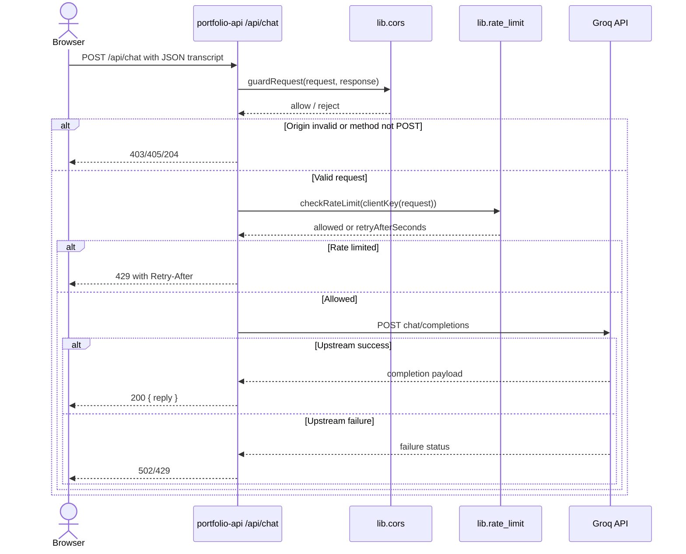

# Chat with the KhunKao assistant

## Overview

This endpoint accepts a chat transcript from the portfolio site and forwards it to Groq for a completion response. It is implemented as a Vercel serverless function and is routed by the file-based `api/*.ts` convention.

The route validates the request origin, applies shared CORS preflight and method checks, enforces a per-IP rate limit, and then sends the transcript plus a system prompt to Groq. The final reply is returned as JSON to the caller.

## Contract

| Property | Value |
| --- | --- |
| Method and route | `POST /api/chat` |
| Request media type | `application/json` |
| Response media type | `application/json` |
| Version | Not specified in source |

## Authentication and authorization

This endpoint does not require a user login. Instead, it enforces browser-origin validation and server-side credentials:

- `Origin` must be one of the values listed in `lib/cors.ts`.
- `OPTIONS` requests are answered with `204` by the shared guard.
- Non-`POST` methods are rejected with `405`.
- The server calls Groq using `Authorization: Bearer ${GROQ_API_KEY}`; the environment variable is read server-side and is not sent to the browser.

## Request

| Field | Location | Type | Required / nullable | Constraints / default | Meaning |
| --- | --- | --- | --- | --- | --- |
| messages | Body | array | Required, non-null | Length 1..20; each item must be a `{ role, content }` object | Full chat transcript to answer |
| messages[].role | Body | string | Required, non-null | Must be `"user"` or `"assistant"` | Speaker role in the transcript |
| messages[].content | Body | string | Required, non-null | 1..1000 chars, non-empty after trim | Message text |

Additional constraints from source:

- The transcript must end on the visitor turn (`messages[messages.length - 1].role === "user"`).
- The endpoint rejects malformed or empty payloads with `400 { "error": "invalid_request" }`.
- The `website` honeypot field is not used in this route; chat validation is transcript-based only.

## Responses

| Status | Condition | Body |
| --- | --- | --- |
| 200 | Completion generated successfully | `{ "reply": "..." }` |
| 400 | Request body missing or invalid | `{ "error": "invalid_request" }` |
| 403 | Origin not allowed | `{ "error": "origin_not_allowed" }` |
| 405 | Method not `POST` | `{ "error": "method_not_allowed" }` |
| 429 | Rate limited | `{ "error": "rate_limited", "retryAfterSeconds": n }` |
| 500 | Missing env or internal failure | `{ "error": "server_misconfigured" }` or `{ "error": "internal_error" }` |
| 502 | Groq returned a non-success response or empty completion | `{ "error": "upstream_error" }` or `{ "error": "empty_response" }` |

## Errors

| Status | Code / message | Trigger | Caller action |
| --- | --- | --- | --- |
| 204 | Preflight success | `OPTIONS` request | Browser completes CORS preflight |
| 400 | `invalid_request` | Invalid transcript schema or final turn rule | Send a valid message array |
| 403 | `origin_not_allowed` | `Origin` missing or disallowed | Use an approved site origin |
| 429 | `rate_limited` | Per-IP window exhausted | Retry after `Retry-After` |
| 500 | `server_misconfigured` | `GROQ_API_KEY` not set | Set env var on deployment |
| 502 | `upstream_error` | Groq request failed | Retry later or inspect provider status |

## Behavior

- The assistant injects a system prompt from `lib/knowledge.ts` and appends a language directive based on the last user message.
- Thai input is answered in Thai; other languages are answered in English.
- The maximum completion length is capped at `MAX_COMPLETION_TOKENS = 400`.
- The endpoint keeps a best-effort, in-memory rate limit keyed by client IP from `x-forwarded-for` or a fallback value.
- The implementation deliberately logs upstream provider errors server-side instead of echoing provider text to the browser.

## Relationships

| Target | Interaction | Trigger / condition | Failure behavior |
| --- | --- | --- | --- |
| `lib.cors` | shared request guard | Every request | `403`/`405`/`204` responses are produced before route logic |
| `lib.rate_limit` | per-IP limiter | After payload validation | `429` with `Retry-After` |
| `lib.knowledge` | prompt source | Every completion request | System prompt is missing or stale if the module is changed unexpectedly |
| `external.groq` | outbound HTTPS request | Valid configured request | `502`/`429` surfaced as API errors |

## Request flow



## Examples

Synthetic success example:

```json
{
  "messages": [
    { "role": "user", "content": "Tell me about Kittipat's work." }
  ]
}
```

Example success response:

```json
{
  "reply": "Kittipat is a software engineer and product builder..."
}
```

Example invalid request:

```json
{
  "messages": []
}
```

Example failure response:

```json
{ "error": "invalid_request" }
```

## Limits and operations

- `MAX_MESSAGES = 20`
- `MAX_CHARS_PER_MESSAGE = 1000`
- `MAX_COMPLETION_TOKENS = 400`
- Rate limit is best-effort in-memory and does not claim cross-instance enforcement.
- Deployment requires the server-side environment variable `GROQ_API_KEY`.
- The route is served under Vercel as a file-based endpoint with a 30s max function duration from `vercel.json`.

## Evidence and verification

Source reviewed:

- `api/chat.ts` for request validation, rate limiting, and Groq fetch logic
- `lib/cors.ts` for CORS and method/origin enforcement
- `lib/rate-limit.ts` for limiter behavior
- `lib/knowledge.ts` for system prompt content
- `vercel.json` for Vercel function configuration

Structural/reference validation was not claimed here; the CLI validation status is reported separately. The semantic check remains `skipped` unless explicitly executed by the SpecKub CLI.
