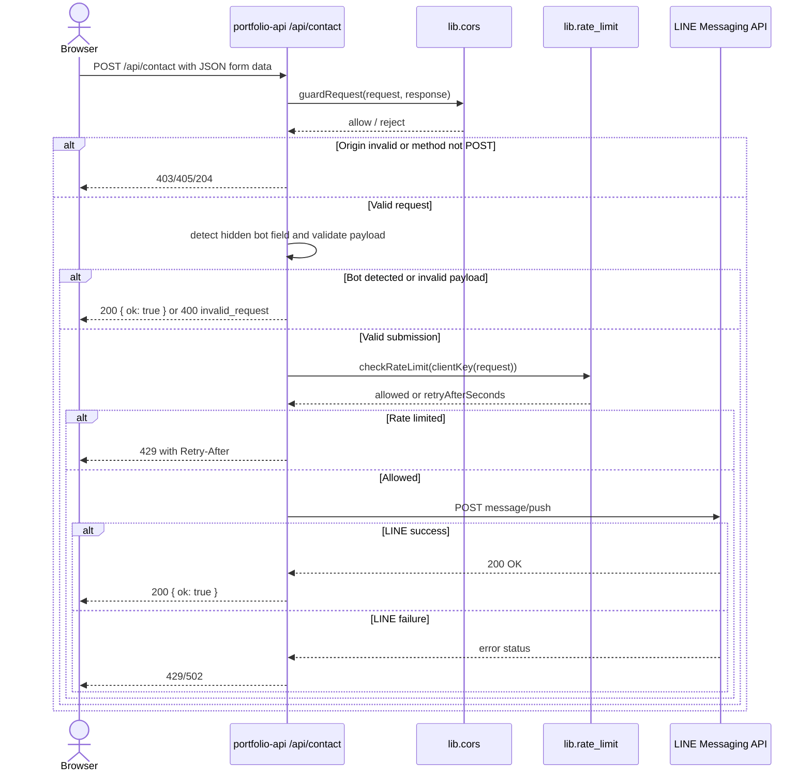

# Contact form submission

## Overview

This endpoint accepts a portfolio contact message, validates it, blocks obvious bots with a hidden honeypot field, and pushes the resulting message to the configured LINE user.

It is a Vercel serverless endpoint that shares the project-wide CORS and method guard with the other API routes. It enforces a rate limit before sending a message to LINE and returns structured JSON responses for success and failure cases.

## Contract

| Property | Value |
| --- | --- |
| Method and route | `POST /api/contact` |
| Request media type | `application/json` |
| Response media type | `application/json` |
| Version | Not specified in source |

## Authentication and authorization

This route does not authenticate a user account. It checks:

- `Origin` must match the allowed list in `lib/cors.ts`.
- `OPTIONS` requests are answered with `204`.
- Non-`POST` requests get `405`.
- Server-side LINE credentials are required to send the message: `LINE_CHANNEL_ACCESS_TOKEN` and `LINE_USER_ID`.

The request is not signed with user auth; the protected resource is the LINE outbound push itself.

## Request

| Field | Location | Type | Required / nullable | Constraints / default | Meaning |
| --- | --- | --- | --- | --- | --- |
| name | Body | string | Required, non-null | 1..100 chars after trim | Sender display name |
| email | Body | string | Required, non-null | 1..200 chars; must match email regex | Sender email address |
| content | Body | string | Required, non-null | 1..2000 chars after trim | Freeform message body |
| website | Body | string | Optional, nullable | If non-empty, caller is treated as a bot | Hidden honeypot field |

Additional validation rules:

- `website` is checked for a non-empty value; in that case the route responds `200 { "ok": true }` without sending a LINE message.
- The route strips leading/trailing whitespace before validating and sending.
- A malformed payload triggers `400 { "error": "invalid_request" }`.

## Responses

| Status | Condition | Body |
| --- | --- | --- |
| 200 | Message accepted and pushed successfully | `{ "ok": true }` |
| 200 | Honeypot detected | `{ "ok": true }` |
| 400 | Invalid payload or malformed email | `{ "error": "invalid_request" }` |
| 403 | Origin not allowed | `{ "error": "origin_not_allowed" }` |
| 405 | Method not `POST` | `{ "error": "method_not_allowed" }` |
| 429 | Rate limited | `{ "error": "rate_limited", "retryAfterSeconds": n }` |
| 500 | Missing LINE env or internal failure | `{ "error": "server_misconfigured" }` or `{ "error": "internal_error" }` |
| 502 | LINE push failed | `{ "error": "upstream_error" }` |

## Errors

| Status | Code / message | Trigger | Caller action |
| --- | --- | --- | --- |
| 204 | Preflight success | `OPTIONS` request | Browser completes CORS preflight |
| 400 | `invalid_request` | Missing or malformed fields | Correct the form payload |
| 429 | `rate_limited` | Too many valid submissions from same client IP | Retry after `Retry-After` |
| 500 | `server_misconfigured` | Missing LINE env vars | Configure deploy secrets |
| 502 | `upstream_error` | LINE push failed | Retry later |

## Behavior

- The route builds a single LINE text message with a subject line and the sender details.
- It deliberately counts rate limits only after validation so malformed input does not consume quota.
- The hidden `website` field is treated as a bot-indicator and is intentionally not documented as part of the actual user-visible form.
- It sends the message to the configured LINE user and logs the provider response only on server side.

## Relationships

| Target | Interaction | Trigger / condition | Failure behavior |
| --- | --- | --- | --- |
| `lib.cors` | shared request guard | Every request | 204 / 403 / 405 returned before business logic |
| `lib.rate_limit` | per-IP limiter | After payload validation | 429 with `Retry-After` |
| `external.line_push` | outbound HTTPS push | Valid non-bot submission | 502 / 429 returned as upstream errors |

## Request flow



## Examples

Synthetic successful request:

```json
{
  "name": "Ada Lovelace",
  "email": "ada@example.com",
  "content": "Hi Kittipat, I would like to discuss a project."
}
```

Success response:

```json
{ "ok": true }
```

Bot-like payload:

```json
{
  "name": "Bot",
  "email": "bot@example.com",
  "content": "Hello",
  "website": "https://example.com"
}
```

Response:

```json
{ "ok": true }
```

## Limits and operations

- `MAX_NAME_CHARS = 100`
- `MAX_EMAIL_CHARS = 200`
- `MAX_CONTENT_CHARS = 2000`
- Default rate limit is `3` requests per hour per client IP unless `CONTACT_RATE_LIMIT` is overridden locally.
- This route expects server-side environment variables `LINE_CHANNEL_ACCESS_TOKEN` and `LINE_USER_ID`.
- The implementation is intended for browser-form usage and is not a general-purpose public API with authentication.

## Evidence and verification

Source reviewed:

- `api/contact.ts` for validation, honeypot logic, rate limit, and LINE push
- `lib/cors.ts` for shared origin and method enforcement
- `lib/rate-limit.ts` for limiter semantics
- `vercel.json` for project function runtime definition

Structural/reference validation was not claimed here; the CLI validation status is reported separately. The semantic check remains `skipped` unless explicitly executed by the SpecKub CLI.
