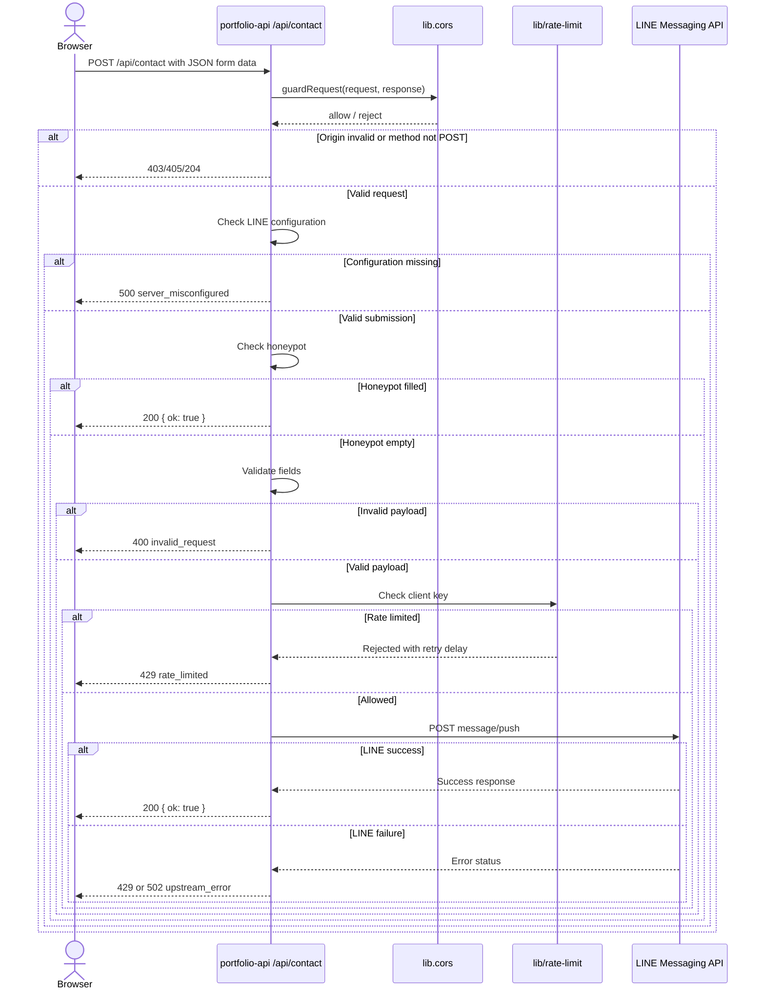

# Contact form submission

## Overview

This endpoint accepts a portfolio contact message, validates it, blocks obvious bots with a hidden honeypot field, and pushes the resulting message to the configured LINE user.

It is a Vercel serverless endpoint that shares the project-wide CORS and method guard with the other API routes. It enforces a rate limit before sending a message to LINE and returns structured JSON responses for success and failure cases.

## Contract

| Property | Value |
| --- | --- |
| Method and route | `POST /api/contact` |
| Request media type | `application/json` |
| Response media type | `application/json` |
| Version | Not specified in source |

## Authentication and authorization

There is no visitor account authentication. `guardRequest` requires a present `Origin` matching the allowlist in `lib/cors.ts`: `https://kittipat.dev`, `https://www.kittipat.dev`, and `https://ipondnakab.github.io`. `OPTIONS` receives `204`, unsupported methods receive `405`, and missing or unlisted origins receive `403`. Server-side `LINE_CHANNEL_ACCESS_TOKEN` and `LINE_USER_ID` are required to send the message; their values are not included here.

## Request

| Field | Location | Type | Required / nullable | Constraints / default | Meaning |
| --- | --- | --- | --- | --- | --- |
| name | Body | string | Required, non-null | Nonempty after trim; maximum 100 original characters | Sender display name |
| email | Body | string | Required, non-null | Nonempty after trim; maximum 200 original characters and must match the email pattern after trim | Sender email address |
| content | Body | string | Required, non-null | Nonempty after trim; maximum 2,000 original characters | Freeform message body |
| website | Body | string | Optional; other types are ignored by honeypot detection | A nonempty string returns the bot response without sending to LINE | Honeypot field |

Additional validation rules:

- `website` is checked for a non-empty value; in that case the route responds `200 { "ok": true }` without sending a LINE message.
- The route trims `name`, `email`, and `content` before sending. Length limits apply before trimming.
- A malformed payload triggers `400 { "error": "invalid_request" }`.

## Responses

| Status | Condition | Body |
| --- | --- | --- |
| 200 | Message accepted and pushed successfully | `{ "ok": true }` |
| 200 | Honeypot detected | `{ "ok": true }` |
| 204 | CORS preflight (`OPTIONS`) | Empty body |
| 400 | Invalid payload or malformed email | `{ "error": "invalid_request" }` |
| 403 | Origin not allowed | `{ "error": "origin_not_allowed" }` |
| 405 | Method not `POST` | `{ "error": "method_not_allowed" }` |
| 429 | Rate limited | `{ "error": "rate_limited", "retryAfterSeconds": n }` |
| 500 | Missing LINE configuration or unexpected exception | `{ "error": "server_misconfigured" }` or `{ "error": "internal_error" }` |
| 502 | LINE push failed with status other than 429 | `{ "error": "upstream_error" }` |

## Errors

| Status | Code / message | Trigger | Caller action |
| --- | --- | --- | --- |
| 204 | Preflight success | `OPTIONS` request | Browser completes CORS preflight |
| 400 | `invalid_request` | Missing or malformed fields | Correct the form payload |
| 429 | `rate_limited` | More than the configured hourly limit of valid submissions for the client key | Retry after `Retry-After` |
| 500 | `server_misconfigured` | Missing LINE env vars | Configure deploy secrets |
| 500 | `internal_error` | Unexpected exception during submission | Retry later; no automatic retry is implemented |
| 429 | `upstream_error` | LINE returns HTTP 429 | Retry later; no `Retry-After` from this handler is established |
| 502 | `upstream_error` | LINE returns another non-success status | Retry later; no automatic retry is implemented |

## Behavior

- The route builds a single LINE text message with a subject line and the sender details.
- It deliberately counts rate limits only after validation so malformed input does not consume quota.
- The hidden `website` field is treated as a bot-indicator and is intentionally not documented as part of the actual user-visible form.
- It sends the message to the configured LINE user and logs provider failure details only server-side.
- The default limit is 3 valid submissions per hour per client key. `CONTACT_RATE_LIMIT` can override the positive numeric limit; missing, invalid, or non-positive values fall back to 3.

## Relationships

| Target | Interaction | Trigger / condition | Failure behavior |
| --- | --- | --- | --- |
| `portfolio-api.lib.cors` | Shared in-process request guard | Every request | Ends with `204`, `403`, or `405` before contact logic |
| `portfolio-api.lib.rate-limit` | In-process limiter | Valid, non-bot payload after validation | `429 rate_limited` with `Retry-After` |
| `external.line.push` | Outbound HTTPS JSON request | Required LINE configuration and allowed rate limit | LINE 429 maps to `429 upstream_error`; other non-success statuses map to `502 upstream_error`; exceptions map to 500 |

## Request flow



## Examples

Synthetic successful request:

```json
{
  "name": "Ada Lovelace",
  "email": "ada@example.com",
  "content": "Hi Kittipat, I would like to discuss a project."
}
```

Success response:

```json
{ "ok": true }
```

Bot-like payload:

```json
{
  "name": "Bot",
  "email": "bot@example.com",
  "content": "Hello",
  "website": "https://example.com"
}
```

Response:

```json
{ "ok": true }
```

## Limits and operations

- `MAX_NAME_CHARS = 100`
- `MAX_EMAIL_CHARS = 200`
- `MAX_CONTENT_CHARS = 2000`
- Default rate limit is `3` valid requests per hour per client key; a positive numeric `CONTACT_RATE_LIMIT` overrides it in the process environment.
- This route expects server-side environment variables `LINE_CHANNEL_ACCESS_TOKEN` and `LINE_USER_ID`.
- The implementation is intended for browser-form usage and is not a general-purpose public API with authentication.

## Evidence and verification

Source reviewed:

- `api/contact.ts` for validation, honeypot logic, rate limit, and LINE push
- `lib/cors.ts` for shared origin and method enforcement
- `lib/rate-limit.ts` for limiter semantics
- `vercel.json` for project function runtime definition

The diagram is source-reviewed but not render-tested. SpecKub structural/reference validation is reported separately; the CLI semantic check remains `skipped`.
