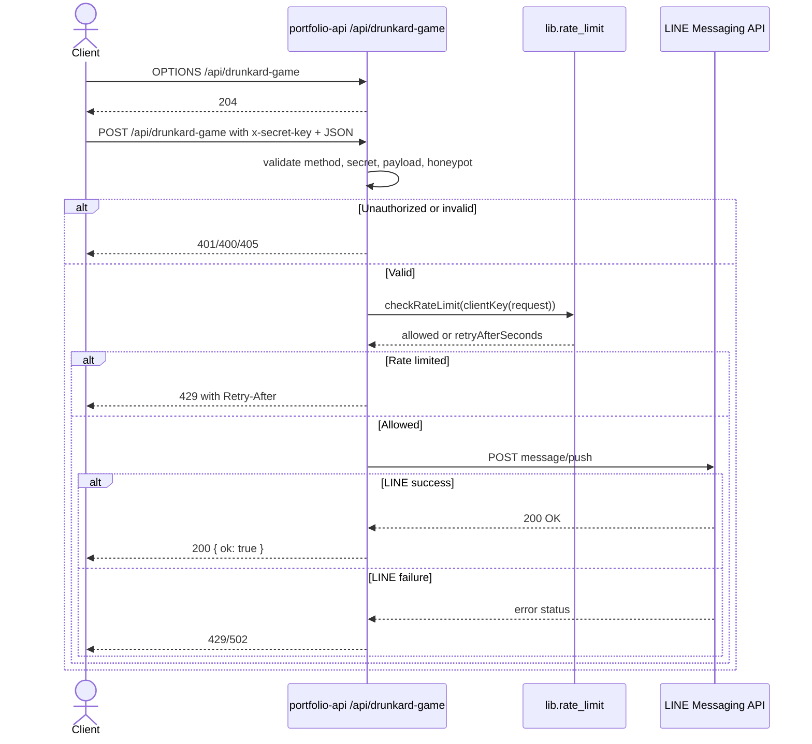

# Drunkard Game submission

## Overview

This endpoint accepts a contact-form style submission for the Drunkard Game feature and validates it before delivering a LINE message to the configured recipient. Unlike the general contact endpoint, it enforces a custom `x-secret-key` header check and accepts `OPTIONS` as a preflight-style request.

The route is implemented directly in its own Vercel handler and is discovered by the file-based `api/*.ts` router in the project.

## Contract

| Property | Value |
| --- | --- |
| Method and route | `POST /api/drunkard-game` |
| Request media type | `application/json` |
| Response media type | `application/json` |
| Version | Not specified in source |

## Authentication and authorization

This route uses a custom shared-secret header rather than browser-origin auth alone:

- `OPTIONS` requests are explicitly allowed with `204` response.
- `POST` is required; other methods receive `405 { "error": "method_not_allowed" }`.
- The header `x-secret-key` must match `process.env.DRUNKARD_GAME_SECRET_KEY` exactly.
- If the secret is missing or mismatched, the route returns `401 { "error": "unauthorized" }`.
- The server also reads `LINE_CHANNEL_ACCESS_TOKEN` and `LINE_USER_ID` from environment variables before sending a LINE push.

## Request

| Field | Location | Type | Required / nullable | Constraints / default | Meaning |
| --- | --- | --- | --- | --- | --- |
| x-secret-key | Header | string | Required | Must equal server secret | Auth secret sent by the game client |
| name | Body | string | Required, non-null | 1..100 chars after trim | Sender display name |
| email | Body | string | Required, non-null | 1..200 chars; valid email pattern | Sender email address |
| content | Body | string | Required, non-null | 1..2000 chars after trim | Message text |
| website | Body | string | Optional, nullable | If non-empty, request is rejected as bot-like | Hidden honeypot field |

Additional validation rules:

- A non-empty `website` field causes `parseDrunkardGamePayload` to return `null`, which becomes `400 { "error": "invalid_request" }`.
- The route does not perform origin allowlist checks in this handler; that logic is implemented in a separate route and not in this file.

## Responses

| Status | Condition | Body |
| --- | --- | --- |
| 204 | `OPTIONS` preflight | Empty response |
| 200 | Message accepted and pushed successfully | `{ "ok": true }` |
| 400 | Invalid payload or hidden-bot trap | `{ "error": "invalid_request" }` |
| 401 | Secret header missing or wrong | `{ "error": "unauthorized" }` |
| 405 | Non-`POST` method | `{ "error": "method_not_allowed" }` |
| 429 | Rate limited | `{ "error": "rate_limited", "retryAfterSeconds": n }` |
| 500 | Missing LINE env or internal failure | `{ "error": "server_misconfigured" }` or `{ "error": "internal_error" }` |
| 502 | LINE push failed | `{ "error": "upstream_error" }` |

## Errors

| Status | Code / message | Trigger | Caller action |
| --- | --- | --- | --- |
| 204 | Preflight success | `OPTIONS` request | Browser or client can continue with the request |
| 400 | `invalid_request` | Malformed payload or honeypot field | Fix request body |
| 401 | `unauthorized` | Missing or bad secret header | Supply the correct secret header |
| 405 | `method_not_allowed` | Non-POST method | Use `POST` |
| 429 | `rate_limited` | Too many valid submissions from same client IP | Retry after `Retry-After` |
| 500 | `server_misconfigured` | Missing LINE env vars | Configure deploy secrets |
| 502 | `upstream_error` | LINE push failed | Retry later |

## Behavior

- The route keeps a simple in-memory rate limit with a fixed budget of `3` requests per hour.
- The message is assembled in the same style as the main contact form but prefixed with `📮 Drunkard Game contact`.
- Request validation occurs before the rate limit check and before the LINE push.
- The route logs provider failure details server-side instead of exposing provider text to callers.

## Relationships

| Target | Interaction | Trigger / condition | Failure behavior |
| --- | --- | --- | --- |
| `lib.rate_limit` | per-IP limiter | After secret and payload validation | `429` with `Retry-After` |
| `external.line_push` | outbound HTTPS push | Valid authorized request | `502`/`429` returned as upstream errors |

## Request flow



## Examples

Synthetic valid request:

```json
{
  "name": "Ada Lovelace",
  "email": "ada@example.com",
  "content": "I want to join the Drunkard Game event.",
  "website": ""
}
```

Headers:

```http
x-secret-key: my-secret
```

Example success response:

```json
{ "ok": true }
```

Example unauthorized response:

```json
{ "error": "unauthorized" }
```

## Limits and operations

- `RATE_LIMIT_PER_HOUR = 3`
- `MAX_NAME_CHARS = 100`
- `MAX_EMAIL_CHARS = 200`
- `MAX_CONTENT_CHARS = 2000`
- The route requires `DRUNKARD_GAME_SECRET_KEY` in the deployment environment and `LINE_CHANNEL_ACCESS_TOKEN` / `LINE_USER_ID` for LINE delivery.
- This handler does not implement CORS origin checks; it enforces header-based auth and method checks directly.

## Evidence and verification

Source reviewed:

- `api/drunkard-game.ts` for method gating, secret validation, payload checks, rate limiting, and LINE push
- `lib/rate-limit.ts` for limiter semantics
- `dev-server.ts` for route registration in the local shim

Structural/reference validation was not claimed here; the CLI validation status is reported separately. The semantic check remains `skipped` unless explicitly executed by the SpecKub CLI.
