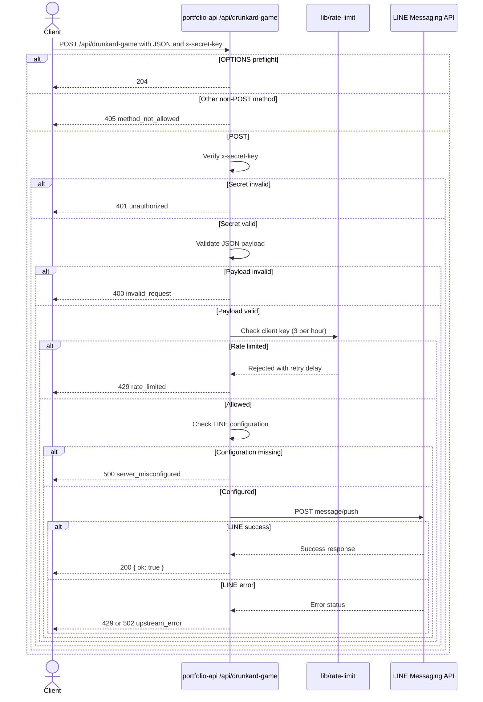

# Drunkard Game contact submission

## Overview

Accepts a contact payload from the Drunkard Game integration, validates a shared secret header and the JSON fields, then sends a text message to the configured LINE user. This handler is part of the `portfolio-api` service.

## Contract

| Property | Value |
| --- | --- |
| Method and route | `POST /api/drunkard-game` |
| Request media type | `application/json` |
| Response media type | `application/json` |
| Version | Not specified in source |

## Authentication and authorization

The handler requires `x-secret-key` to exactly match the nonempty `DRUNKARD_GAME_SECRET_KEY` environment value. It does not call the shared `guardRequest`; therefore the source does not apply the `Origin` allowlist to this route. `OPTIONS` receives `204` before secret validation, while other non-POST methods receive `405`. LINE delivery additionally requires `LINE_CHANNEL_ACCESS_TOKEN` and `LINE_USER_ID`; values are not included here.

## Request

Send `Content-Type: application/json` and the required secret header. The body must be an object with nonempty `name`, `email`, and `content` strings. Maximum original string lengths are 100, 200, and 2,000 characters respectively; email is checked against the source regex after trimming. The values are trimmed before building the outbound message. A nonempty string `website` causes validation to fail. Other `website` types are ignored, and additional body properties are unused.

| Field | Location | Type | Required / nullable | Constraints / default | Meaning |
| --- | --- | --- | --- | --- | --- |
| `x-secret-key` | Header | string | Required, nonempty | Exact match to `DRUNKARD_GAME_SECRET_KEY`; no default | Shared-secret request authorization |
| name | Body | string | Required, non-null | Nonempty after trim; maximum 100 original characters | Sender display name |
| email | Body | string | Required, non-null | Nonempty after trim; maximum 200 original characters; must match email regex after trim | Sender email address |
| content | Body | string | Required, non-null | Nonempty after trim; maximum 2,000 original characters | Message body |
| website | Body | string | Optional | A nonempty string fails validation | Honeypot value |

There are no path or query parameters.

### JSON request example

```json
{
  "name": "Ada Lovelace",
  "email": "ada@example.invalid",
  "content": "I would like to share feedback about the game."
}
```

The example values are synthetic. The secret header is omitted from the body example and must be supplied separately; no secret value is shown. No defaults are applied to omitted fields.

## Responses

| Status | Condition | Body |
| --- | --- | --- |
| 200 | LINE push succeeds | `{ "ok": true }` |
| 204 | `OPTIONS` preflight | Empty body |
| 400 | Payload invalid, including a nonempty string honeypot | `{ "error": "invalid_request" }` |
| 401 | Missing, empty configured secret, or mismatched `x-secret-key` | `{ "error": "unauthorized" }` |
| 405 | Method is not `POST` or handled `OPTIONS` | `{ "error": "method_not_allowed" }` |
| 429 | Per-instance rate limit reached or LINE returns HTTP 429 | `{ "error": "rate_limited", "retryAfterSeconds": n }` for local limit; `{ "error": "upstream_error" }` for LINE 429 |
| 500 | LINE configuration missing or unexpected exception | `{ "error": "server_misconfigured" }` or `{ "error": "internal_error" }` |
| 502 | LINE returns non-success status other than 429 | `{ "error": "upstream_error" }` |

The handler sets `Retry-After` for its own rate limit. It does not establish a `Retry-After` header for an upstream LINE 429.

## Errors

| Status | Code / message | Trigger | Caller action |
| --- | --- | --- | --- |
| 400 | `invalid_request` | Missing, malformed, over-limit, or invalid fields; nonempty string `website` | Correct the JSON payload |
| 401 | `unauthorized` | `x-secret-key` does not match the configured nonempty secret | Configure the caller and deployment consistently |
| 405 | `method_not_allowed` | Method is not `POST` or `OPTIONS` | Use `POST` |
| 429 | `rate_limited` | More than 3 requests in the handler's 60-minute in-memory window for the client key | Wait for `Retry-After` when provided |
| 500 | `server_misconfigured` | Missing `LINE_CHANNEL_ACCESS_TOKEN` or `LINE_USER_ID` after payload and rate checks | Configure deployment variables |
| 500 | `internal_error` | Unexpected exception during LINE request handling | Retry later; no automatic retry is implemented |
| 429 / 502 | `upstream_error` | LINE returns an error; status 429 remains 429 and other failures map to 502 | Retry according to caller policy; this handler does not retry automatically |

## Behavior

The handler checks `OPTIONS`, method, secret header, payload, and rate limit in that order. It then checks LINE configuration and synchronously sends a LINE Messaging API push request. The outbound text includes a fixed subject, sender name, email, and content. No idempotency key or automatic retry is implemented.

The route's `clientKey` helper reads `x-forwarded-for` and falls back to `unknown`; the source does not verify that the header is trustworthy in every deployment configuration. The limiter is in-memory per warm serverless instance, not a globally shared quota.

## Relationships

| Target | Interaction | Trigger / condition | Failure behavior |
| --- | --- | --- | --- |
| `portfolio-api.lib.rate-limit` | In-process limiter | After secret and payload validation | `429 rate_limited` with `Retry-After` |
| `external.line.push` | Outbound HTTPS JSON request | Valid request, matching secret, allowed limit, and LINE configuration | LINE 429 maps to `429 upstream_error`; other non-success statuses map to `502 upstream_error`; exceptions map to 500 |

No API-to-API caller or asynchronous event relationship was established in the inspected repository. The frontend repository is outside this scan scope. Relationship identities are recorded in `.speckub/relations.md`.

## Request flow



The sequence follows `api/drunkard-game.ts` handler order. `clientKey` is imported from `lib/cors.ts`, but that helper only derives the limiter key; the shared `guardRequest` and origin check are not invoked by this handler.

## Examples

Synthetic request:

```sh
curl -X POST https://portfolio-api.example.invalid/api/drunkard-game \
  -H 'Content-Type: application/json' \
  -H 'x-secret-key: <configured-secret>' \
  --data '{"name":"Ada Lovelace","email":"ada@example.invalid","content":"I would like to share feedback about the game."}'
```

The placeholder above is not a credential and must be replaced by the caller from its secure configuration.

Representative success response:

```json
{ "ok": true }
```

Representative unauthorized response:

```json
{ "error": "unauthorized" }
```

The host and responses are illustrative and have not been sent to a server.

## Limits and operations

- `name`: at most 100 original characters; `email`: at most 200; `content`: at most 2,000.
- Rate limit: 3 requests per 60 minutes per client key in memory for each warm serverless instance.
- `vercel.json` sets a 30-second maximum function duration. No separate upstream timeout is configured in the handler.
- The local `dev-server.ts` has a 100,000-character request-body cap; a matching production cap is not established by inspected source.
- Required environment variable names: `DRUNKARD_GAME_SECRET_KEY`, `LINE_CHANNEL_ACCESS_TOKEN`, and `LINE_USER_ID`. Values are intentionally omitted.

## Evidence and verification

Source reviewed: `api/drunkard-game.ts` (`handler`, `verifySecretHeader`, `parseDrunkardGamePayload`), `lib/cors.ts` (`clientKey`; `guardRequest` is not called here), `lib/rate-limit.ts` (`createRateLimiter`), `dev-server.ts` (local route mapping and body cap), and `vercel.json` (function duration). No runtime test or Mermaid rendering is claimed here. SpecKub structural/reference validation is reported separately; the CLI semantic check remains `skipped`.
